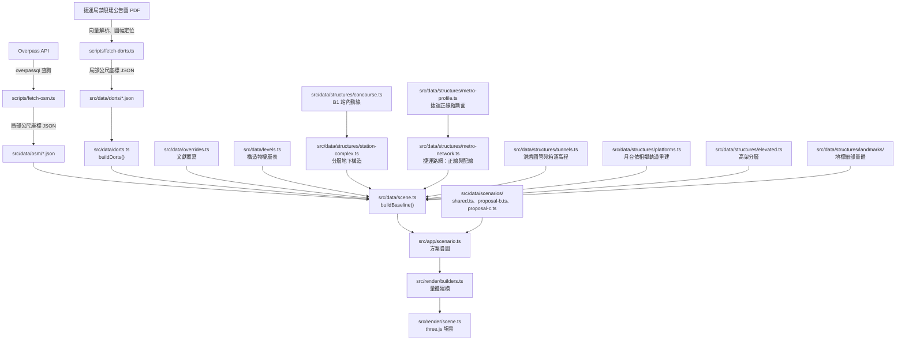

# 架構

本文件說明 KitaMeet 的資料流、座標系統、資料結構與渲染方式，供後續維護與資料更新時參考。

## 資料流

擷取與渲染完全分離：`npm run fetch:osm` 與 `npm run fetch:dorts` 僅在需要更新圖資時執行，網站執行期不連外。產出的 `src/data/osm/underground.json`、`surface.json` 與 `indoor.json` 進版控，目前分別為 242、8974 與 249 項；`src/data/dorts/structures.json` 與 `basemap.json` 亦進版控，PDF 快取則留在 `data/cache/dorts/`，不進版控。`npm run fetch:osm -- indoor` 可只更新指定的資料集。

`indoor.json` 為站內動線的室內圖資，格式與另外兩份不同：除了通道、階梯與付費區的 way，另收電梯與出入口的 node，`level`、`incline`、`conveying` 等標籤原樣保留，由 `concourse.ts` 解讀。

`classify()` 判深度只看 `location` 與 `level`（`isUnderground()`），不看 `layer`：市區建物為了壓在高架橋下常標 `layer=-1`，照此判定會將台北凱撒大飯店、金融中心、中正紀念堂等整棟地面建物當成地下街埋入 B1，再以地下範圍裁切後浮在地面界線之外。停車場也僅在 `parking=underground` 時歸入地下街；其中帶 `amenity=parking` 者於 `convert()` 改列 `parking` 類型，圖層仍為地下街，但只畫 0.2 公尺厚的樓面，不長成實心量體。

`convert()` 分兩輪：先走 `way`、記下成為圖徵者，再走 `relation`；多重多邊形的外環若整圈由已自成圖徵的成員 way 串成，關聯與成員的幾何完全重合，捨棄該環只留成員並回報。桃園機場捷運台北車站（`relation/7684913`）與國立台灣藝術教育館（`relation/7875303`）即為此例，原本兩份共面量體在畫面上互閃。

## 座標系統

- 專案原點為 WGS84 的 25.0478° N、121.5172° E，位於臺北車站站體中心附近。
- 投影採 EPSG:3826（TWD97 TM2，中央經線 121 度），減去原點的 TM2 座標後得局部公尺座標，x 為東、y 為北。
- three.js 場景座標為 X = x、Y = 高程、Z = −y，維持右手座標系。
- 資料層的高程一律為 EL：自基隆平均海水面起算、向上為正。場景 Y 以站區地面（`GROUND_EL`，EL +4.5）為 0，換算只在 `src/render/depth.ts` 的 `sceneY()`，相機、空拍薄板與永久連結因此不受高程基準影響。
- 經緯度換算只出現在 `src/geo/project.ts`；渲染端一律使用局部公尺座標。

擷取範圍為兩圈涵蓋範圍的外接矩形加 100 公尺餘裕，地下與地面共用：25.0294–25.0594° N、121.4895–121.5395° E，定義於 `data/queries/*.overpassql` 的 `[bbox:…]` 設定。腳本由查詢檔讀取後寫入產出檔的檔頭，並在轉檔時依涵蓋範圍濾除界外的圖徵（全部頂點都在環外且離界線超過 80 公尺者）。

## 涵蓋範圍與裁切

場景的範圍由 `src/data/coverage.ts` 的兩圈封閉多邊形決定，頂點以 WGS84 宣告、載入時換算為局部公尺座標，並以 `polygonArea > 0` 斷言逆時針：裁切的內外判定依賴這項約定。

| 範圍 | 界線 |
|---|---|
| 地面（`OVERGROUND_RING`） | 北緣南京東西路、西緣淡水河西岸、南緣莒光路—和平西路二段—南海路—仁愛路、東緣建國南北路 |
| 地下（`UNDERGROUND_RING`） | 北緣推至民生東西路、西緣再外推至機場捷運過河隧道末端以西、南緣推至信義路，另含捷運中正紀念堂站的凸出段；西緣的莒光路緯度以南與整段南緣、東緣與地面範圍共用 |

`clipToCoverage(feature)` 依量體所屬圖層選範圍（`UNDERGROUND_LAYERS` 列的車站量體、月台、股道、地下街、捷運、通道與禁限建範圍取地下，其餘取地面），因此地下結構可以伸出地面範圍之外。不以底面高程判定：水域與人行地下道的底面為負值，卻該隨地面範圍裁切。多邊形交給 `clipPolygonToRing()`、折線與隧道軸心交給 `splitPolylineByRing()`：後者回傳界內與界外兩組子線段，裁切只取界內。單一線段可能數次進出凹形的環，實作因此逐段求出所有交點，再以各子線段的中點判定側別。切出多塊時 id 加上 `#n` 後綴；帶 `elevations` 的折線與圓管，各段逐頂點取原縱斷面在該處的高程；只有兩端高程的斜帶量體，各段的 `base`、`baseEnd` 由 `fractionAlong()` 依弧長內插。只有上緣輪廓（`polygonTop`）做形心判定留去：其頂點需與 `polygon` 一一對應，切開會失真。

兩支裁切函式的內外一律以 `pointInPolygon()` 判定，不走 `sideOfPolyline()`：涵蓋範圍帶有凸出段，其凹角背後有一整片扇形區域的最近線段是同一個頂點，取最近線段判側會在該處得到相反的答案。離開界內後沿環的行進方向補回轉角頂點，跨越範圍轉角的大面才不會被弦切掉一角。

裁切在 `buildBaseline()` 中早於禁限建公告圖的建物比對：比對依形心判定，裁切會使形心移位，順序顛倒會讓跨越界線的建物在比對後才變形，與公告圖的房屋面重疊。

涵蓋範圍內的地面另以一塊地塊量體呈現：平面即 `OVERGROUND_RING`、厚 60 公尺（`TERRAIN_DEPTH`）、不透明度 0.08，承接陰影但不投射陰影。地塊本身不裁切。

## 樓層標籤與構造物深度

`LevelId`（`elevated`、`G`、`B1`–`B4`）只是樓層標籤，不代表深度：臺鐵高鐵站體的 B2 為月台層、樓板 EL −6.476，機場捷運 A1 的 B2 為貨物裝卸與機電設備層、樓板 EL −9.36。

實際深度由 `src/data/levels.ts` 的 `STRUCTURES` 決定，每個構造物各有一份 `floor`（樓板高程）與 `height`（淨高）的樓層表，另記結構底高程。`levelOf(structure, level)` 為唯一查詢入口；構造物未指定、或該構造物沒有這一層時回退 `src/data/schema.ts` 的預設樓層表，不拋出例外。捷運台北車站分為板南線站體（`metro-station`）與淡水信義線站體（`metro-station-r`）兩份樓層表：兩線站體各自獨立興建、深度不同，同標為 B3 的樓層一為板南線月台層、一為淡水信義線大廳層。

| 代號 | 名稱 | 預設樓板高程 | 預設層高 |
|---|---|---|---|
| `elevated` | 高架層 | EL +12.5（離地 8.0） | 9.0 公尺 |
| `G` | 地面層 | EL +4.5 | 7.0 公尺 |
| `B1` | 地下一層 | EL −2.5（離地 −7.0） | 6.0 公尺 |
| `B2` | 地下二層 | EL −10.0（離地 −14.5） | 7.5 公尺 |
| `B3` | 地下三層 | EL −17.5（離地 −22.0） | 7.5 公尺 |
| `B4` | 地下四層 | EL −25.0（離地 −29.5） | 7.5 公尺 |

結構樓板面即軌道面，以 `railLevelOf(structure, level)` 取得；月台自樓板再長高 1.1 公尺。另有 `levelLabelFor(elevation)` 依高程取最接近的預設樓層標籤，供不屬於任何構造物的量體（公告圖隧道、路線正線）決定圖層面板的樓層開關。離地高度以 `aboveGround(offset)` 換算為 EL，是否位於地面以 `atGround(elevation)` 判定：容差 1e-6 公尺，涵蓋範圍的裁切內插會留下微小的浮點誤差，不能以全等比較。各構造物的實際深度列於 `docs/status-quo.md`。

## 分層地下構造

OSM 只有 2D 輪廓，捷運台北車站與機場捷運 A1 站各只有單一巨大多邊形。兩者於覆寫表標為 `exclude`，改由 `src/data/structures/station-complex.ts` 的 `buildStationComplex()` 產生分層量體，於 `buildBaseline()` 併入場景：站體的逐層樓板、捷運兩線的樓板與大廳、A1 的樓板、大廳與地下量體，以及 B1 的站內動線、B3 共用穿堂與捷運站內的梯組。捷運月台的梯組依重建後的月台平面配置（見〈月台重建〉），`buildBaseline()` 因此在月台重建之後才呼叫 `buildStationComplex()`，並傳入查詢重建後月台平面的函式。

B1 的站內動線由 `src/data/structures/concourse.ts` 的 `buildConcourse()` 依 `indoor.json` 產生：通道依 `level` 標籤與連通關係分為站體、捷運、地下街三類，地下街層的通道再依 `mallFloor()` 取最近一座地下街的 B1 樓板（K 區與 Z 區不等高）；階梯與電扶梯依 `incline` 標籤與兩端所接的通道決定起訖高程，電梯取鄰近通道的樓層為停靠層。站體 B1 的樓板範圍為常數 `STATION_B1_FOOTPRINT`，描自網路資料的地下一層平面圖；東停車場同樣描自該圖，由 `eastParkingFeature()` 產生。分階規則與各類量體的數量見 `docs/status-quo.md` 的〈站內動線〉。已由 OSM 基礎流程畫出的地下街通道只用於判定樓層，不重複產生量體。

月台層下方的 B3 共用穿堂另由同一模組的 `buildB3Concourse()` 產生，由 `buildStationComplex()` 併入場景。穿堂 `station/concourse/B3` 的平面取四座月台電扶梯（OSM 標 `highway=pedestrian`、`conveying` 與 `level=-3`，每座月台下方一座）各 8 公尺寬的帶狀，連同各座沿自身方向延伸到公告圖淡水信義線車站箱涵的交點後求凸包，樓板 EL −11.156、淨高 3.0 公尺；四座月台電扶梯自該樓板通到月台面。

捷運站內的梯組依臺北捷運〈台北車站資訊圖〉配置，OSM 沒有對應的圖徵，由同一模組的兩支函式沿重建後的月台主軸產生。`buildMetroTransfer()` 產生板南線大廳層的北側延伸段 `metro/bannan/concourse/B2/north`（淡水信義線箱涵在月台南端以南的部分），以及延伸段中段通往淡水信義線月台的 `metro/transfer/B4`、北端通往淡水信義線大廳層的 `metro/transfer/B3/west` 與 `metro/transfer/B3/east` 三組梯組；`buildBannanPlatformAccess()` 產生板南線大廳層通往島式月台的四組梯組 `metro/bannan/platform/1` 至 `4`。每組梯組由並排的電扶梯與階梯組成，各道的 id 為 `<梯組 id>/<kind>/<同類序號>`，坡度 30 度。地下街輪廓內標到 `level` −3 的電梯以該地下街的停車場層為底。

方案拆除地下街時，`src/app/scenario.ts` 的 `clearMall()` 以該地下街輪廓為界清除站內動線，只套用在 `layer === "passage"` 且樓層為 B1 或 G 的量體，B3 的穿堂與捷運站內的梯組不在其列。`kind === "passage"` 的通道以 `splitPolylineByRing()` 切開：界內段另立 `<id>/cleared`（第二段起 `<id>/cleared/n`）並標為拆除，界外段沿用原 id（第二段起 `<id>/kept/n`）。階梯、電扶梯、電梯與出入口雨棚不切開，只要有一個頂點落在輪廓內即整座標為拆除。

出地面的階梯與電扶梯（`atGround(baseEnd)`）另由 `src/data/structures/exit-shed.ts` 的 `buildExitSheds()` 產生出入口雨棚：自地面端沿折線取最多 10 公尺的區段，於兩側與後端立 1.1 公尺高的矮牆、四角立柱撐起離地 3.6 公尺的頂棚，正面不封。地面端落在離地 2 公尺以上建物輪廓內者視為開在建物內的出入口，不產生雨棚；頂棚平面內的 OSM 建物面（多為 `building=roof` 的雨棚）改由雨棚量體呈現，地標不在此列。雨棚與階梯同樣依地下街輪廓判定，頂點落在拆除的地下街範圍內即一併標為拆除。

臺鐵高鐵站體與 A1 的平面取自 OSM 輪廓；捷運兩線的平面則取自公告圖的車站箱涵：以含 OSM 月台形心者為準（數個箱涵都包含時取面積最小者），找不到即擲出例外。板南線的 B2、B3 樓板與 B2 大廳層只取箱涵中月台西端以東的部分，西端以外是疊式段轉為左右並列處，下層軌道在此爬升到月台層；淡水信義線的 B3、B4 樓板與 B3 大廳層只取月台兩端之間的部分，月台所在的箱涵是淡水線臺北車站至雙連的明挖箱涵，正線出站後在其中爬升到 B2。月台兩端取 OSM 原始輪廓，與縱斷面界定站區的範圍一致。深度一律取該構造物的樓層表，不新增座標常數。

## 地標細部量體

地標若只把輪廓拉高，街廓裡就是一塊塊方盒子，看不出哪一棟是哪一棟。二十座地標因此改由 `src/data/structures/landmarks/` 依現場照片的立面比例拆成台基、柱列、腰線、簷口、屋頂斜面與塔冠等量體，於 `buildBaseline()` 併入場景。

目錄逐座一檔，各匯出 `build<Name>()` 與 `claim()`；共用工具集中於 `frame.ts`，`index.ts` 只負責串接與快取。`LANDMARK_MODEL_IDS` 列出四座於覆寫表標為 `exclude` 的 OSM 建物，其餘靠認領範圍移除重疊量體。

平面一律由既有輪廓推算，不新增座標常數：`outline(id)` 依 OSM id 取回既有圖徵、`outlineNear(lon, lat)` 依錨點取面積最大的建物面，台座與塔樓另可用 `dortsFaceIn()` 取公告圖地形圖的房屋面（形心落在輪廓內、面積最大的一塊）。方位由 `minAreaRect()` 的最小面積外接矩形決定：建物輪廓的頂點疏密不均，`polygonAxis()` 的主成分分析會被密集的轉角拉偏。需要正立面時改以 `faceFrame()` 取朝向指定方位的外牆，先把方向相近的連續邊併為一段（輪廓常把一面牆切成數段短邊），再取法線最正對目標者；`lateral` 一律朝輪廓外，順時針與逆時針輪廓皆然。朝向目標由 `towards(ring, bearing)` 自形心沿方位取遠點給出，不另宣告座標。

每座地標各自宣告一塊認領範圍（即其既有輪廓），形心落在範圍內的建物量體一律由 `buildBaseline()` 移除：地形圖常把一座地標切成好幾塊房屋面，光靠排除 OSM 輪廓會留下疊在細部量體裡的方塊。

總高有文獻者取文獻值，其餘依正立面照片以平面尺寸為比例尺換算，量體一律標為 `estimated` 並於 `sourceNote` 說明換算方式；逐座的採用值見 `docs/status-quo.md`。

## 禁限建公告圖

`npm run fetch:dorts` 自捷運局的查詢系統取得逐幅向量 PDF，解析為局部公尺座標的 JSON。流程分為四步，各有獨立模組：

| 模組 | 作用 |
|---|---|
| `scripts/dorts/pdf.ts` | 以 `node:zlib` 解開內容流，解析 PDF 路徑運算子與圖層標記，輸出帶圖層名的向量路徑 |
| `scripts/dorts/georef.ts` | 以 50 公尺 TWD67 方格網求比例與方向、以指北針定北，再以格網落在 50 公尺整數倍的條件校正平移 |
| `scripts/dorts/layers.ts` | 依圖層名分為結構外緣、限建線、軌道中心線、建物與道路五類 |
| `scripts/dorts/structures.ts`、`basemap.ts` | 沿軌道中心線量測淨寬切出潛盾與箱形段；地形圖的建物線段以平面圖解析求面 |

旋轉角一律由格網與指北針決定，不可改用圖框四角的最小平方套合：矩形有 180 度旋轉對稱，四角對應有兩組殘差同為零的解，會使部分圖幅整幅翻轉。比例亦逐幅自格網求取，`SA01RWSS02A` 的圖面比例與其餘圖幅相差 5.8%，以相鄰圖幅的建物吻合度（中位數 0.03 公尺）證實。

腳本結束前輸出品質報告，格網殘差、格網校正量、相鄰圖幅建物吻合度與「限建線距結構外緣 50 公尺」任一項超出門檻即以非零狀態結束，不寫出產出檔。

涵蓋範圍內的平面幾何一律以公告圖為準：建物面取代比對到的 OSM 建物並承接其高度與名稱、軌道中心線為捷運正線的平面來源（見〈捷運路網〉）；範圍外與無對應者維持 OSM。公告圖所附地形圖的道路邊線不再輸出為量體：路緣改由合併後的路面自己界定。隧道與軌道中心線先去重（某條折線 90% 以上的頂點落在另一條 1.5 公尺內即捨棄較短者），避免相鄰圖幅與鄰線參考畫法使同一條結構以兩種顏色、兩種深度重複繪出。所屬路線以幾何判定（頂點到 OSM 有 `ref` 正線的距離中位數最小且不超過 25 公尺），無命中才回退圖幅代號：圖幅會將鄰線結構當作參考一併繪出，僅靠圖幅代號會將鄰線結構塗成自己的顏色。

軌道中心線以點劃線繪製，串接時跨越劃與劃之間的間隙（12 公尺內）。`chainSegments()` 的 `maxLateral` 限制跨越間隙時偏離行進方向的側向距離，軌道取 1 公尺：渡線附近並行兩軌相距僅數公尺，不設限時會橫跳到另一軌，在剪式渡線與臺北車站西端接出垂直的短段與 V 形折返。道路邊線與限建線不設限。圖幅索引另有不在 `EXPECTED_SHEETS` 的圖幅時只列出警告、不納入；缺少清單上的圖幅即中止。

公告圖的潛盾軸線常伸進車站箱涵。`dortsBores()` 以 `trimBoreAtStations()` 將潛盾止於同路線車站箱涵（寬度達 20 公尺者）的外牆：兩端各自檢查端部 6 公尺內每 0.5 公尺的軸點與兩側管緣，任一點落在箱涵內就自該端削去 0.5 公尺，至多 40 次；削後不足 1 公尺者捨棄。`dortsBores()` 只提供潛盾的平面範圍與管徑，圓管由 `tunnels.ts` 沿正線產生，見〈潛盾圓管與箱涵〉。

## 捷運正線縱斷面

`src/data/structures/metro-profile.ts` 決定本範圍每條捷運正線（板南線、淡水信義線、松山新店線、中和新蘆線）的軌道面高程。`METRO_STOPS` 列出 16 個停靠站的月台層：層別依臺北捷運〈車站剖面相關位置圖〉，有樓層表者（臺北車站、北門、兩座疊式車站）取構造物的樓層，其餘取預設樓層表（B2 −10、B3 −17.5、B4 −25）。西門與中正紀念堂的 `level` 為 `"stacked"`，上下層由通過的鏈決定。

`METRO_CHAINS` 列出 8 條依行車方向首尾相接的 OSM 正線鏈，每條路線每個行車方向各一條，各附量體 id（如 `metro/bl/to-nangang`）、終點站名與折線排列方向 `ends`。`chainControls(chain, points)` 在組成後的正線折線上求出水平段：

- 站區：該站 `extent` 列出的月台面、站體輪廓與渡線，以及 `extentBoxesAt` 指到的公告圖車站箱涵，其頂點投影到正線上（30 公尺內者）的弧長範圍，高程為該站月台層。
- 疊式段（`holds`）：自 `from` 的投影起，止於 `until` 的投影；`until` 為 `{ boxAt }` 時止於正線與該車站箱涵外牆最近的交點。

相鄰兩段以 3%（`MAX_GRADE`）連接，坡段緊鄰較淺的一段：較淺者在後即於其起點爬升到頂，在前即自其終點開始下降，結果與鏈的方向無關。鏈的 `steep` 指定的兩站之間改用 3.5%（`STEEP_GRADE`）。坡段長於兩段的間距、兩段重疊或鏈未經過停靠站即擲出例外，不以加大坡度矇混。鏈首與鏈尾沿用最近一段的高程。

## 捷運路網

`src/data/structures/metro-network.ts` 的 `buildMetroNetwork()` 產生全部捷運軌道：每條路線每個行車方向一條連續的正線，以及逐條列明銜接對象的配線。OSM 的捷運軌道 way 不直接成為量體：`buildBaseline()` 在裁切前刪去全部 `track-metro`，未列入 `NETWORK_WAY_IDS` 與 `EXCLUDED_WAYS` 者若有任何部分落在涵蓋範圍內即擲出例外。

公告圖的軌道中心線是繪圖筆畫而非一條條軌道：一筆常自正線經渡線畫到另一條正線，疊式段兩軌在平面上重合時也只畫一筆。正線的平面因此依下列步驟組成：

1. 筆畫切段：其他筆畫的端點落在本筆畫 1 公尺內處（交會點），以及兩筆畫相距 1 公尺內、連續 20 公尺以上的重合段兩端，各切一刀；相距 2 公尺內的切點併為一個，短於 1 公尺的段捨棄，每段加密為 2 公尺內一個頂點。
2. 歸屬：各段取頂點到 8 條 OSM 正線鏈距離的中位數，最小者超過 7 公尺即不採用；離任一條配線比離該鏈近 1 公尺以上者視為配線；沿段 30 公尺內兩點的側距相差超過 3.5 公尺者為斜穿兩軌的渡線，亦不採用。同一路線另一條鏈的中位數不超過最小者加 1.5 公尺時，該段同屬兩條正線（疊式段）。
3. 取用：各鏈的段落依側距（四捨五入到公尺）由小到大、同側距取較長者，逐段去除投影落在已取段落範圍內的頂點，保留 20 公尺以上的最長連續部分。
4. 補足：段落之間與公告圖未涵蓋處取 OSM 正線，加密後平移到兩端段落的端點。兩端皆有段落且間距短於 120 公尺時平移量依弧長線性內插，否則各端的平移量在 60 公尺內遞減到零。
5. 平滑：每 2 公尺重取樣，以前後各 5 點的置中移動平均做 3 次，近兩端時窗口對稱縮小，端點不動；最大偏移超過 1 公尺即擲出例外。
6. 依 `ends` 排成行車方向，在縱斷面轉折點補上頂點，逐點寫入 `elevations`。

`networkDiagnostics()` 回報各正線的公告圖採用長度與最大平滑偏移。機場捷運的兩條正線（`metro/a/north`、`metro/a/south`）只取 OSM，同樣重取樣與平滑，全段為 A1 車站 B3 軌道面。

配線表 `LINKS` 逐條列出 OSM way、路線、類型（渡線、聯絡線、中線折返軌、側線、機廠線）、首末端銜接的軌道（`joins`，依 OSM 頂點順序，`null` 為不銜接）與高程算法。西門站北側的 `way/194585055` 拆為上下兩條：往松山接往南港展覽館、往新店接往頂埔。配線先加密，端點移到所銜接軌道上的最近點（距離超過 8 公尺即擲出例外），內部頂點依弧長比例平移；銜接配線的配線待被銜接者建立後才處理，互相銜接的中線折返軌由先建者保留該端原位。高程依兩端軌道面線性內插、逐點取兩條正線的平均，或取機場捷運軌道面；任一段縱坡超過 3.5% 即擲出例外。

## 潛盾圓管與箱涵

`src/data/structures/tunnels.ts` 在路網建立之後執行。`boreTubes()` 只沿正線每 0.5 公尺取樣，落在同路線潛盾軸線 3.5 公尺內、且投影在軸線兩端之內者屬於該潛盾，同一潛盾的連續取樣（2 公尺以上）成為一段圓管：軸線即該段正線，各頂點的軸心高出軌道面 1.5 公尺，記於 `elevations`；環片厚 0.25 公尺（`TBM_LINING`）。多條潛盾都涵蓋時沿用前一點的潛盾，否則取最近者：相鄰圖幅與疊式段常有兩條潛盾範圍重合，逐點取最近者會來回跳動，切出零碎的短管。id 為 `潛盾 id@正線 id`。公告圖將疊式雙管畫成一條時，上下兩條正線各得一管。`airportTwinBore()` 產生機場捷運的雙圓潛盾 `a/dot-bore`：軸線取兩條正線的中線，東端止於北門站西緣（x −747.7），西端依全長 1,582 公尺回推，斷面為兩個外半徑 3.1 公尺、圓心相距 5.2 公尺的圓（`twinSpacing`），環片厚 0.3 公尺。`fitBoxesToTracks()` 將公告圖箱涵的底板改為箱涵內同路線軌道最低的軌道面減 1.5 公尺；車站箱涵頂版維持地面下 5 公尺，明挖箱涵的淨高為 9 公尺加箱涵內軌道的高差。

## 月台重建

`src/data/structures/platforms.ts` 的 `rebuildPlatforms()` 依相鄰軌道重建 `PLATFORM_REBUILDS` 所列的 19 座月台，於 `buildBaseline()` 組出量體清單後立即套用，後續的站區分層構造與雨棚沿用重建後的陣列。相鄰軌道的候選由 `platformTracks()` 給出：臺鐵高鐵月台取 `track-tra`、`track-hsr`，機場捷運取 `a` 線的軌道，捷運取該路線的全部軌道（路網正線與配線）。捷運月台與軌道同高，OSM 月台與軌道的平面差距會使兩者相交，故停靠站的月台一律重建。重建後的月台再以涵蓋範圍裁切一次：月台取固定長度，位於範圍邊緣者會伸出界外。

沿月台主軸每 2 公尺取一個位置，各候選軌道取前後 1 公尺內、側向在原月台半寬加 8 公尺內的取樣點（連續的正線會在遠處再次經過同一段主軸範圍），以中位數判定位於哪一側、以最靠近主軸的一點外推月台邊緣距離；軌道斜交主軸時，橫向間距放大為 edge·√(1 + 斜率²)。某一位置缺某側軌道時沿用同側最近一個有值的位置。寬度不足 2 公尺處為原輪廓伸入道岔區的部分，取寬度達標的最長連續區段；該區段短於原長之半即表示軌道選錯，擲出例外。捷運月台的長度取 6 節列車長 141 公尺。

方案的基準座標系 `platform1Axis()` 取第 1 月台的 OSM 原始輪廓，不隨月台重建移動。

## 量體結構

渲染端唯一認得的資料結構為 `Feature`：

| 欄位 | 說明 |
|---|---|
| `id` | OSM id（如 `way/584167409`）、公告圖識別字串（如 `dorts/N/bore/3`）、捷運路網的識別字串（如 `metro/bl/to-nangang`）或方案量體的識別字串 |
| `level` | 所屬樓層標籤 |
| `structure` | 所屬構造物，決定該樓層標籤對應的實際深度 |
| `layer` | 圖層代號，亦為圖層面板的開關單位 |
| `line` | 所屬系統或路線（`tra`、`hsr`、`bl`、`r`、`g`、`o`、`a`），決定著色 |
| `base`、`baseEnd`、`elevations`、`height`、`width`、`radius` | 底面高程、折線與圓管末端的底面高程（傾斜量體；圓管為軸心）、各頂點的底面高程（有此欄位者不設 `baseEnd`）、高度、折線量體寬度、圓形隧道半徑 |
| `lining`、`twinSpacing` | 圓管的環片厚度、雙圓潛盾兩圓心的間距 |
| `trackRole`、`joins` | 捷運軌道在路網中的角色（正線、渡線、聯絡線、中線折返軌、側線、機廠線）、配線首末端銜接的軌道 id |
| `confidence` | `sourced`、`derived` 或 `estimated` |
| `sourceNote` | 資料依據或推估方式 |
| `status` | `existing`、`added`、`removed` 或 `repurposed` |

`confidence` 的三級定義為：`sourced` 出自文獻或官方資料並附來源、`derived` 由 OSM 幾何或文獻值計算而得、`estimated` 為本專案推估。

圖層共 13 組：地標建物、一般建物、高架道路、道路、公園水域、地塊、車站量體、月台、股道、地下街、捷運、通道、禁限建範圍。地標與一般建物分屬不同圖層，可單獨關閉周邊街廓而保留地標；二十座細部建模的地標各部量體也都歸入地標圖層。公園水域承載公園、綠地、廣場與水域的面狀量體，地塊則只有涵蓋範圍的土方量體一項。禁限建範圍會蓋住整個畫面，預設關閉。

## 渲染

多邊形以 `ExtrudeGeometry` 長出高度，折線先由中心線往兩側平移成封閉帶狀再長出厚度，圓形隧道則沿軸心掃出斷面（`sweep()`），三者都在建模時將高程烘焙進頂點。沿線高程不一的折線量體為斜板（`slopedBand()`）；階梯則沿線等分為數級（`steppedBand()`，每級高差約 0.6 公尺、至少 3 級），每級各是一塊頂面水平的量體，級數為示意，不等於實際階數。

多邊形量體另可指定 `geometry.polygonTop`：頂點數與 `polygon` 相同時改以 `loft()` 放樣，側面逐段四邊形相連、上下面各自封口。屋頂斜面、塔冠收分與外傾的翹角都靠這一支產生；上緣輪廓由 `insetRing()`（正值內縮、負值出挑）或框架矩形給出。放樣的各面不共用頂點，法線才逐面平直，屋面與塔冠不致被平滑成圓弧。

折線量體的各頂點高程（`elevations`，或由 `base`、`baseEnd` 依弧長內插）不全相同時改以 `slopedBand()` 建模：左右緣各取一次平移，各頂點的高程先求得才各自放大，再組出上下面、側面與端面。引道、匝道與依縱斷面起伏的捷運軌道藉此連續呈現，不致出現段差。

地下高程於建模時放大 1.2 倍，使各層的相對關係在畫面上分辨得出。單一入口為 `src/render/depth.ts` 的 `sceneY()`：先減去地面高程 `GROUND_EL`，地面以下的部分再乘以放大倍率；於 `buildFeatureMesh` 中套用於量體的上下兩端高程、高度取兩端之差，資料層一律保存真實的 EL。

圓管的斷面由 `tubeSection()` 給出：單圓為外半徑 `radius`、內孔扣除環片厚度的圓環；雙圓為兩個相交的圓，兩個內孔之間留下 0.3 公尺厚的中央柱。每整圈 16 段。沿軸線掃出時，平面切向取前後頂點的連線，斷面的側向為其左法線、垂直方向一律朝上，斷面因此保持直立；兩端以斷面三角化封口。放大只作用於各頂點的軸心高程，斷面維持真實尺寸，否則隧道會被壓成與斷面不符的扁管。圓管與車站外殼同樣只繪製背面、不透明度 0.4，內部的軌道與環片厚度看得見。

紙模型色調以 `MeshStandardMaterial` 為底（`roughness` 0.95、`metalness` 0），於 `onBeforeCompile` 注入菲涅耳邊緣提亮與極淡的垂直漸層，不加描邊。著色優先序為方案狀態、量體類型的中性色，最後才是圖層；只有股道與隧道再混入所屬路線色（`LINE_TINT`，股道 0.6、隧道 0.2），站體、樓板、大廳與月台一律維持中性暖灰，路線色因此只出現在線形上。路線色見 `LINE_COLORS`：捷運各線取自維基百科 Template:台北捷運色彩並與底色混色降彩度，臺鐵與高鐵無對應的捷運色，另取鐵灰與橘，與板南線藍、淡水信義線紅拉開距離。車站量體與樓板以半透明呈現，外殼僅繪製背面，使內部的月台與股道不致遭到遮蔽；樓板、外殼與地塊另設 `polygonOffset` 退讓給貼在其上的量體，避免共面造成閃爍。光照為半球光加單一平行光，色調映射採 ACES Filmic。

著色量體與中性量體的相交由 `tests/collisions.test.ts` 逐點取樣檢查：股道與隧道的中心線、兩側邊線與箱涵格點逐一比對其他量體的柱體，垂直重疊超過 0.05 公尺即記為相交。既知相交清單 `KNOWN_COLLISIONS` 為空；新增的相交只有附上 (a) 歷年施工改動、看似衝突實則不然，或 (b) 已盡力搜尋仍查無證據的說明與出處，才得列入。清單內的相交消失時測試同樣失敗。該測試只回報，不影響算繪。

面狀地物一律為極淡的半透明色塊、無邊框：地塊 0.08、路面與水域 0.35、綠地 0.3、廣場 0.25、停車場樓面 0.45、電梯井道 0.55。公園、綠地與廣場只長 0.15 公尺的薄層，水域則長出實際水深，採用值見 `docs/status-quo.md`。

涵蓋範圍內有上萬項量體，逐項一個 mesh 時繪製呼叫的數量本身就使畫面低於 30 fps。`Viewer.setFeatures()` 因此把外觀與擺放方式相同的量體以 `BufferGeometryUtils.mergeGeometries()` 併為單一 mesh，分組鍵涵蓋圖層、樓層、類型、方案狀態、顏色、不透明度、底面高程與繪製旗標，即 `applyMorph()` 與材質會用到的每一項，分組因此不改變任何呈現行為。幾何先統一為無索引、只留位置與法線：`ExtrudeGeometry` 帶 uv 而不帶索引、放樣與斜帶量體帶索引而不帶 uv，屬性組合不一致時無法合併。場景不做量體挑選，合併後也不影響互動。

## 道路面合併

OSM 的道路為中心線，逐條依等級推估路寬後外擴成帶，路口與並行路段會互相重疊，疊出深淺不一的色塊。`src/data/scene.ts` 的 `mergeRoadSurfaces()` 因此把同一組（類型、樓層、底面高程、厚度相同）的路面帶合併為單一路面網格：各帶的邊展開為線段集合後交給 `polygonize()` 求面，重疊處即被分割為互不重疊的小面；再保留形心落在任一路面帶內的面，街廓與圓環中央等被道路圍住的面因此捨棄。

兩端高程不同的匝道與引道不合併，維持逐條呈現，否則坡度會被壓平。合併後的量體 id 為 `road/merged/<組別>/<序號>`，不再帶路名。

`buildViaduct()` 必須在合併之前呼叫，且取未裁切的橋面：橋墩定位依賴逐條高架主線的幾何，柱距才不會在涵蓋範圍的切口重新起算。

## 高架分層

高架橋面的高程不是單一常數，否則忠孝橋、市民大道、環河快速道路在塔城街口會等高互穿。`src/data/structures/elevated.ts` 以實際交叉關係定層：兩條車行橋面在平面上相交、不共用節點、且 OSM `layer` 不同時，`layer` 大者在上；層級自 0 起逐層疊加 6.4 公尺（市區道路車道淨高 4.6 公尺加主線梁深 1.8 公尺），最低層的橋面頂沿用 `LEVELS.elevated` 的 EL +12.5（離地 8.0 公尺）。各橋面端點的高程取相接橋面中的最高者，再以不超過 6% 的縱坡沿橋面放坡，層級變化因此由鄰接橋面吸收。絕對高程仍為推估值，但何者在上為可信。

橋面的判定只看 `bridge` 標籤是否存在且 `layer` 為正，不限 `bridge=yes`：環河南路快速道路、新北環河快速道路與中山高架均標為 `bridge=viaduct`。匝道鏈除 `*_link` 外另含無 `bridge` 標籤的 `trunk` 落地段（忠孝橋西端、環河快速道路的連接段在 OSM 本身即無標籤），其節點高程沿橋面端與地面端的鏈長內插；兩端都已落地者仍為地面道路。

橋墩沿各橋面中心線每 40 公尺一柱（跨徑取《中華技術》〈都市高架快速道路之設計與施工〉所載市民大道跨徑的下限），柱心即中心線上的點，柱頂接該處以兩端高程內插的橋面底面，柱底落在河道多邊形內者伸至河床 EL −5.0。雙幅並行的橋面在 8 公尺內且柱頂高差小於 1 公尺者共用一柱，不同層的交疊處則各自立柱。

## 視圖模式

- **3D**：透視相機，`OrbitControls` 操作，地面由涵蓋範圍的地塊量體呈現，幾乎全透明，可透視地下結構。
- **空拍**：正投影相機、固定正俯視，隱藏地面以上的圖層與地塊，量體沿高程壓縮為薄板並依樓層分層排列，各層轉為半透明以免互相遮蔽。公園水域在空拍模式仍然顯示。

於空拍模式拖曳旋轉使相機極角超過 2 度時自動切回 3D，並保留當前的視點與目標；縮放與平移不觸發切換。由網址還原狀態時，空拍模式的視點一律拉回目標正上方，避免帶入非俯視的視點後立即觸發切換。

正投影的縮放設上下限 0.15 至 40（`ORTHO_MIN_ZOOM`、`ORTHO_MAX_ZOOM`，相當於視野半高 4,133 至 15 公尺）：`OrbitControls` 的 `minZoom` 預設為 0，不設限時滾輪可將畫面縮到一片空白，而每格只乘 1.05，縮回原尺度要花上百格。與透視距離互換時也套用同一組上下限。

## 剖面

單一 `THREE.Plane` 套用至所有材質的 `clippingPlanes`，方位角以正東為 0 度、逆時針為正，位置為剖切面沿法線方向距原點的公尺數（−800 至 800）。材質的 `side` 為 `DoubleSide`，斷面可見內部結構。

## 永久連結

狀態序列化於 `location.hash`，以 `history.replaceState` 更新，不留下大量瀏覽歷史。

| 參數 | 內容 |
|---|---|
| `v` | 格式版本，目前為 `1` |
| `m` | 視圖模式，`3d` 或 `aerial` |
| `s` | 方案，`status-quo`、`proposal-b` 或 `proposal-c` |
| `loff` | 關閉的圖層代號，以逗號分隔（僅記錄預設開啟者） |
| `lon` | 開啟的圖層代號，以逗號分隔（僅記錄預設關閉者，目前為禁限建範圍） |
| `voff` | 關閉的樓層代號，以逗號分隔 |
| `sec` | 剖面的方位角與位置，僅在啟用時出現 |
| `cam` | 相機位置、目標與縮放，共 7 個數值；位置與目標取小數一位，縮放取三位（正投影的縮放可小於 0.2） |

版本不符或參數缺漏時一律回到預設值，不拋出例外。

## 部署

`npm run build` 先以 `tsc --noEmit` 檢查型別，再由 Vite 建置至 `dist/`。`vite.config.ts` 的 `base` 固定為 `./`，產出的資產路徑相對於 `index.html`，部署在網域根目錄或專案子路徑皆可載入。

`.github/workflows/pages.yml` 於推送至 `main` 時執行測試與建置，再以 `actions/upload-pages-artifact` 與 `actions/deploy-pages` 發布至 GitHub Pages。網站路徑為相對路徑，更名儲存庫或改掛網域根目錄都不需要調整建置設定。
