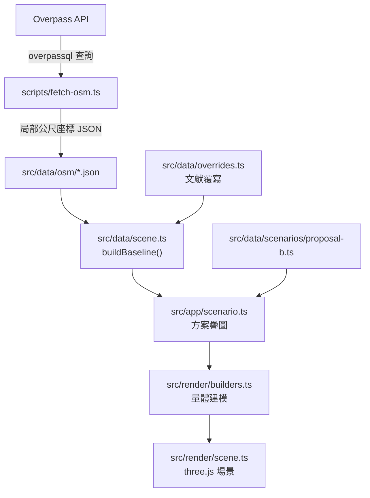

# 架構

本文件說明 KitaMeet 的資料流、座標系統、資料結構與渲染方式，供後續維護與資料更新時參考。

## 資料流

擷取與渲染完全分離：`npm run fetch:osm` 僅在需要更新圖資時執行，網站執行期不連外。產出的 `src/data/osm/underground.json` 與 `surface.json` 進版控，目前分別為 192 與 2294 項量體。

## 座標系統

- 專案原點為 WGS84 的 25.0478° N、121.5172° E，位於臺北車站站體中心附近。
- 投影採 EPSG:3826（TWD97 TM2，中央經線 121 度），減去原點的 TM2 座標後得局部公尺座標，x 為東、y 為北。
- three.js 場景座標為 X = x、Y = 高程、Z = −y，維持右手座標系。
- 經緯度換算只出現在 `src/geo/project.ts`；渲染端一律使用局部公尺座標。

擷取範圍分為兩組：地下結構為 25.0400–25.0580° N、121.5050–121.5330° E；地面建物為 25.0440–25.0530° N、121.5090–121.5250° E。兩組範圍定義於 `data/queries/*.overpassql` 的 `[bbox:…]` 設定，腳本由查詢檔讀取後寫入產出檔的檔頭。

## 樓層高程

定義於 `src/data/schema.ts` 的 `LEVELS`，數值為推估值。

| 代號 | 名稱 | 樓板高程 | 層高 |
|---|---|---|---|
| `elevated` | 高架層 | 8.0 公尺 | 9.0 公尺 |
| `G` | 地面層 | 0 | 7.0 公尺 |
| `B1` | 穿堂層 | −7.0 公尺 | 6.0 公尺 |
| `B2` | 月台層 | −14.5 公尺 | 7.5 公尺 |
| `B3` | 共用穿堂層 | −22.0 公尺 | 7.5 公尺 |
| `B4` | 捷運月台層 | −29.5 公尺 | 7.5 公尺 |

軌道面為該層樓板高程減去月台面高度 1.1 公尺。

## 量體結構

渲染端唯一認得的資料結構為 `Feature`：

| 欄位 | 說明 |
|---|---|
| `id` | OSM id（如 `way/584167409`）或方案量體的識別字串 |
| `kind` | 量體類型，決定建模與著色方式 |
| `level` | 所屬樓層代號 |
| `layer` | 圖層代號，亦為圖層面板的開關單位 |
| `geometry` | `polygon` 或 `polyline`，局部公尺座標 |
| `base`、`height`、`width` | 底面高程、高度、折線量體寬度 |
| `confidence` | `sourced`、`derived` 或 `estimated` |
| `sourceNote` | 資料依據或推估方式 |
| `status` | `existing`、`added`、`removed` 或 `repurposed` |

`confidence` 的三級定義為：`sourced` 出自文獻或官方資料並附來源、`derived` 由 OSM 幾何或文獻值計算而得、`estimated` 為本專案推估。

圖層共 10 組：地標建物、一般建物、高架道路、道路、車站量體、月台、股道、地下街、捷運、通道。地標與一般建物分屬不同圖層，可單獨關閉周邊街廓而保留地標。

## 渲染

多邊形以 `ExtrudeGeometry` 長出高度，折線先由中心線往兩側平移成封閉帶狀再長出厚度，兩者都在建模時將底面高程烘焙進頂點。

紙模型色調以 `MeshStandardMaterial` 為底（`roughness` 0.95、`metalness` 0），於 `onBeforeCompile` 注入菲涅耳邊緣提亮與極淡的垂直漸層，不加描邊。車站量體與樓板以半透明呈現，外殼僅繪製背面，使內部的月台與股道不致遭到遮蔽。光照為半球光加單一平行光，色調映射採 ACES Filmic。

## 視圖模式

- **3D**：透視相機，`OrbitControls` 操作，地面以半透明紙面呈現，可透視地下結構。
- **空拍**：正投影相機、固定正俯視，隱藏地面以上的圖層與地面，量體沿高程壓縮為薄板並依樓層分層排列，各層轉為半透明以免互相遮蔽。

於空拍模式拖曳旋轉使相機極角超過 2 度時自動切回 3D，並保留當前的視點與目標；縮放與平移不觸發切換。

## 剖面

單一 `THREE.Plane` 套用至所有材質的 `clippingPlanes`，方位角以正東為 0 度、逆時針為正，位置為剖切面沿法線方向距原點的公尺數（−800 至 800）。材質的 `side` 為 `DoubleSide`，斷面可見內部結構。

## 永久連結

狀態序列化於 `location.hash`，以 `history.replaceState` 更新，不留下大量瀏覽歷史。

| 參數 | 內容 |
|---|---|
| `v` | 格式版本，目前為 `1` |
| `m` | 視圖模式，`3d` 或 `aerial` |
| `s` | 方案，`status-quo` 或 `proposal-b` |
| `loff` | 關閉的圖層代號，以逗號分隔 |
| `voff` | 關閉的樓層代號，以逗號分隔 |
| `sec` | 剖面的方位角與位置，僅在啟用時出現 |
| `cam` | 相機位置、目標與縮放，共 7 個數值 |

版本不符或參數缺漏時一律回到預設值，不拋出例外。

## 部署

`npm run build` 先以 `tsc --noEmit` 檢查型別，再由 Vite 建置至 `dist/`。`vite.config.ts` 的 `base` 由環境變數 `BASE_PATH` 決定，預設為 `/`。

`.github/workflows/pages.yml` 於推送至 `main` 時執行測試與建置，建置時設定 `BASE_PATH=/kitameet-taipei/`，再以 `actions/upload-pages-artifact` 與 `actions/deploy-pages` 發布至 GitHub Pages。
