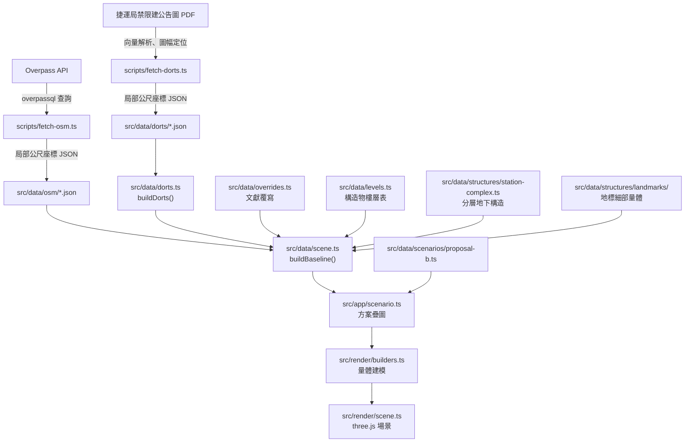

# 架構

本文件說明 KitaMeet 的資料流、座標系統、資料結構與渲染方式，供後續維護與資料更新時參考。

## 資料流

擷取與渲染完全分離：`npm run fetch:osm` 與 `npm run fetch:dorts` 僅在需要更新圖資時執行，網站執行期不連外。產出的 `src/data/osm/underground.json` 與 `surface.json` 進版控，目前分別為 242 與 8963 項量體；`src/data/dorts/structures.json` 與 `basemap.json` 亦進版控，PDF 快取則留在 `data/cache/dorts/`，不進版控。

`classify()` 判深度只看 `location` 與 `level`（`isUnderground()`），不看 `layer`：市區建物為了壓在高架橋下常標 `layer=-1`，照此判定會將台北凱撒大飯店、金融中心、中正紀念堂等整棟地面建物當成地下街埋入 B1，再以地下範圍裁切後浮在地面界線之外。停車場也僅在 `parking=underground` 時歸入地下街。

`convert()` 分兩輪：先走 `way`、記下成為圖徵者，再走 `relation`；多重多邊形的外環若整圈由已自成圖徵的成員 way 串成，關聯與成員的幾何完全重合，捨棄該環只留成員並回報。桃園機場捷運台北車站（`relation/7684913`）與國立台灣藝術教育館（`relation/7875303`）即為此例，原本兩份共面量體在畫面上互閃。

## 座標系統

- 專案原點為 WGS84 的 25.0478° N、121.5172° E，位於臺北車站站體中心附近。
- 投影採 EPSG:3826（TWD97 TM2，中央經線 121 度），減去原點的 TM2 座標後得局部公尺座標，x 為東、y 為北。
- three.js 場景座標為 X = x、Y = 高程、Z = −y，維持右手座標系。
- 經緯度換算只出現在 `src/geo/project.ts`；渲染端一律使用局部公尺座標。

擷取範圍為兩圈涵蓋範圍的外接矩形加 100 公尺餘裕，地下與地面共用：25.0294–25.0594° N、121.4895–121.5395° E，定義於 `data/queries/*.overpassql` 的 `[bbox:…]` 設定。腳本由查詢檔讀取後寫入產出檔的檔頭，並在轉檔時依涵蓋範圍濾除界外的圖徵（全部頂點都在環外且離界線超過 80 公尺者）。

## 涵蓋範圍與裁切

場景的範圍由 `src/data/coverage.ts` 的兩圈封閉多邊形決定，頂點以 WGS84 宣告、載入時換算為局部公尺座標，並以 `polygonArea > 0` 斷言逆時針：裁切的內外判定依賴這項約定。

| 範圍 | 界線 |
|---|---|
| 地面（`OVERGROUND_RING`） | 北緣南京東西路、西緣淡水河西岸、南緣莒光路—和平西路二段—南海路—仁愛路、東緣建國南北路 |
| 地下（`UNDERGROUND_RING`） | 北緣推至民生東西路、西緣再外推至機場捷運過河隧道末端以西、南緣推至信義路，另含捷運中正紀念堂站的凸出段；西緣的莒光路緯度以南與整段南緣、東緣與地面範圍共用 |

各段界線一律取街道中心線向外偏移 15 至 30 公尺以納入該街道本身；南海路與信義路例外，分別向內偏移 15 與 25 公尺以排除南海路本身與東門站。重慶北路一段另北移 45 公尺，使建成圓環整圈落在界內；景福門圓環則整圈納入地面範圍，界線自中山南路東側繞其東南角再接仁愛路。西緣自淡水河西岸切口（121.4905）一路正南至莒光路緯度：新店溪與華江河濱整片在界外，淡水河只保留此緯度以北的河面。

`clipToCoverage(feature)` 依量體所屬圖層選範圍（`UNDERGROUND_LAYERS` 列的車站量體、月台、股道、地下街、捷運、通道與禁限建範圍取地下，其餘取地面），因此地下結構可以伸出地面範圍之外。不以底面高程判定：水域與人行地下道的底面為負值，卻該隨地面範圍裁切。多邊形交給 `clipPolygonToRing()`、折線與隧道軸心交給 `clipPolylineToRing()`，切出多塊時 id 加上 `#n` 後綴；兩端高程不同的斜帶量體照切，各段的 `base`、`baseEnd` 由 `fractionAlong()` 依弧長內插。只有上緣輪廓（`polygonTop`）做形心判定留去：其頂點需與 `polygon` 一一對應，切開會失真。

兩支裁切函式的內外一律以 `pointInPolygon()` 判定，不走 `sideOfPolyline()`：涵蓋範圍帶有凸出段，其凹角背後有一整片扇形區域的最近線段是同一個頂點，取最近線段判側會在該處得到相反的答案。離開界內後沿環的行進方向補回轉角頂點，跨越範圍轉角的大面才不會被弦切掉一角。

裁切在 `buildBaseline()` 中早於禁限建公告圖的建物比對：比對依形心判定，裁切會使形心移位，順序顛倒會讓跨越界線的建物在比對後才變形，與公告圖的房屋面重疊。

涵蓋範圍內的地面另以一塊地塊量體呈現：平面即 `OVERGROUND_RING`、厚 60 公尺（`TERRAIN_DEPTH`，深於最深的 B4 樓板與潛盾段）、不透明度 0.08，承接陰影但不投射陰影。地塊本身不裁切。

## 樓層標籤與構造物深度

`LevelId`（`elevated`、`G`、`B1`–`B4`）只是樓層標籤，不代表深度：臺鐵高鐵站體的 B2 為月台層、深度 −14.5 公尺，捷運台北車站的 B2 為板南線大廳層、深度 −11.0 公尺。

實際深度由 `src/data/levels.ts` 的 `STRUCTURES` 決定，每個構造物各有一份 `floor`（樓板高程）與 `height`（淨高）的樓層表，另記結構底高程。`levelOf(structure, level)` 為唯一查詢入口；構造物未指定、或該構造物沒有這一層時回退 `src/data/schema.ts` 的預設樓層表，不拋出例外。

| 代號 | 名稱 | 預設樓板高程 | 預設層高 |
|---|---|---|---|
| `elevated` | 高架層 | 8.0 公尺 | 9.0 公尺 |
| `G` | 地面層 | 0 | 7.0 公尺 |
| `B1` | 地下一層 | −7.0 公尺 | 6.0 公尺 |
| `B2` | 地下二層 | −14.5 公尺 | 7.5 公尺 |
| `B3` | 地下三層 | −22.0 公尺 | 7.5 公尺 |
| `B4` | 地下四層 | −29.5 公尺 | 7.5 公尺 |

結構樓板面即軌道面，以 `railLevelOf(structure, level)` 取得；月台自樓板再長高 1.1 公尺。另有 `levelLabelFor(elevation)` 依高程取最接近的預設樓層標籤，供不屬於任何構造物的量體（公告圖隧道、路線正線）決定圖層面板的樓層開關。各構造物的實際深度列於 `docs/status-quo.md`。

## 分層地下構造

OSM 只有 2D 輪廓，捷運台北車站與機場捷運 A1 站各只有單一巨大多邊形。兩者於覆寫表標為 `exclude`，改由 `src/data/structures/station-complex.ts` 的 `buildStationComplex()` 產生分層量體，於 `buildBaseline()` 併入場景：站體的逐層樓板、B1 的五條南北向通道與南北迴廊、捷運兩線的樓板與大廳、垂直動線核心、A1 的樓板、大廳與地下量體，以及地下街之間的連通道。

臺鐵高鐵站體與 A1 的平面由 OSM 輪廓推算（`polygonAxis`、`advance`、`offsetPolyline`、`corridorPolygon`、`nearestPair`）；捷運兩線的平面則取自公告圖的車站箱涵——以含 OSM 月台形心者為準，找不到即擲出例外。深度一律取該構造物的樓層表，不新增座標常數。

## 地標細部量體

地標若只把輪廓拉高，街廓裡就是一塊塊方盒子，看不出哪一棟是哪一棟。二十座地標因此改由 `src/data/structures/landmarks/` 依現場照片的立面比例拆成台基、柱列、腰線、簷口、屋頂斜面與塔冠等量體，於 `buildBaseline()` 併入場景。

目錄逐座一檔，各匯出 `build<Name>()` 與 `claim()`；共用工具集中於 `frame.ts`，`index.ts` 只負責串接與快取。`LANDMARK_MODEL_IDS` 列出四座於覆寫表標為 `exclude` 的 OSM 建物，其餘靠認領範圍移除重疊量體。

平面一律由既有輪廓推算，不新增座標常數：`outline(id)` 依 OSM id 取回既有圖徵、`outlineNear(lon, lat)` 依錨點取面積最大的建物面，台座與塔樓另可用 `dortsFaceIn()` 取公告圖地形圖的房屋面（形心落在輪廓內、面積最大的一塊）。方位由 `minAreaRect()` 的最小面積外接矩形決定：建物輪廓的頂點疏密不均，`polygonAxis()` 的主成分分析會被密集的轉角拉偏。需要正立面時改以 `faceFrame()` 取朝向指定方位的外牆，先把方向相近的連續邊併為一段（輪廓常把一面牆切成數段短邊），再取法線最正對目標者；`lateral` 一律朝輪廓外，順時針與逆時針輪廓皆然。朝向目標由 `towards(ring, bearing)` 自形心沿方位取遠點給出，不另宣告座標。

每座地標各自宣告一塊認領範圍（即其既有輪廓），形心落在範圍內的建物量體一律由 `buildBaseline()` 移除：地形圖常把一座地標切成好幾塊房屋面，光靠排除 OSM 輪廓會留下疊在細部量體裡的方塊。

高度以文獻為準、細分為推估：站體總高 48 公尺、新光屋頂 238.15 公尺與尖頂 244.15 公尺、司法大廈 31.8 公尺取自文獻，其餘樓層分段、柱距與屋頂斜度依正立面照片以平面尺寸為比例尺換算，量體一律標為 `estimated` 並於 `sourceNote` 說明換算方式。

## 禁限建公告圖

`npm run fetch:dorts` 自捷運局的查詢系統取得逐幅向量 PDF，解析為局部公尺座標的 JSON。流程分為四步，各有獨立模組：

| 模組 | 作用 |
|---|---|
| `scripts/dorts/pdf.ts` | 以 `node:zlib` 解開內容流，解析 PDF 路徑運算子與圖層標記，輸出帶圖層名的向量路徑 |
| `scripts/dorts/georef.ts` | 以 50 公尺 TWD67 方格網求比例與方向、以指北針定北，再以格網落在 50 公尺整數倍的條件校正平移 |
| `scripts/dorts/layers.ts` | 依圖層名分為結構外緣、限建線、軌道中心線、建物與道路五類 |
| `scripts/dorts/structures.ts`、`basemap.ts` | 沿軌道中心線量測淨寬切出潛盾與箱形段；地形圖的建物線段以平面圖解析求面 |

旋轉角一律由格網與指北針決定，不可改用圖框四角的最小平方套合：矩形有 180 度旋轉對稱，四角對應有兩組殘差同為零的解，會使部分圖幅整幅翻轉。比例亦逐幅自格網求取，`SA01RWSS02A` 的圖面比例與其餘圖幅相差 5.8%，以相鄰圖幅的建物吻合度（中位數 0.03 公尺）證實。

腳本結束前輸出品質報告，格網殘差、格網校正量、相鄰圖幅建物吻合度與「限建線距結構外緣 50 公尺」任一項超出門檻即以非零狀態結束，不寫出產出檔。

涵蓋範圍內的平面幾何一律以公告圖為準：建物面取代比對到的 OSM 建物並承接其高度與名稱、軌道中心線取代 OSM 捷運正線；範圍外與無對應者維持 OSM。公告圖所附地形圖的道路邊線不再輸出為量體：路緣改由合併後的路面自己界定。隧道與軌道中心線先去重（某條折線 90% 以上的頂點落在另一條 1.5 公尺內即捨棄較短者），避免相鄰圖幅與鄰線參考畫法使同一條結構以兩種顏色、兩種深度重複繪出。所屬路線以幾何判定（頂點到 OSM 有 `ref` 正線的距離中位數最小且不超過 25 公尺），無命中才回退圖幅代號：圖幅會將鄰線結構當作參考一併繪出，僅靠圖幅代號會將鄰線結構塗成自己的顏色。深度則全為推估，由 `levels.ts` 的 `METRO_LINES` 給出各路線軌道面高程，潛盾段軸心取 `rail + 1.5`、箱涵底取 `rail − 1.5`。

## 量體結構

渲染端唯一認得的資料結構為 `Feature`：

| 欄位 | 說明 |
|---|---|
| `id` | OSM id（如 `way/584167409`）、公告圖識別字串（如 `dorts/N/bore/3`）或方案量體的識別字串 |
| `level` | 所屬樓層標籤 |
| `structure` | 所屬構造物，決定該樓層標籤對應的實際深度 |
| `layer` | 圖層代號，亦為圖層面板的開關單位 |
| `line` | 所屬系統或路線（`tra`、`hsr`、`bl`、`r`、`g`、`o`、`a`），決定著色 |
| `base`、`baseEnd`、`height`、`width`、`radius` | 底面高程、折線末端的底面高程（傾斜量體）、高度、折線量體寬度、圓形隧道半徑 |
| `confidence` | `sourced`、`derived` 或 `estimated` |
| `sourceNote` | 資料依據或推估方式 |
| `status` | `existing`、`added`、`removed` 或 `repurposed` |

`confidence` 的三級定義為：`sourced` 出自文獻或官方資料並附來源、`derived` 由 OSM 幾何或文獻值計算而得、`estimated` 為本專案推估。

圖層共 13 組：地標建物、一般建物、高架道路、道路、公園水域、地塊、車站量體、月台、股道、地下街、捷運、通道、禁限建範圍。地標與一般建物分屬不同圖層，可單獨關閉周邊街廓而保留地標；二十座細部建模的地標各部量體也都歸入地標圖層。公園水域承載公園、綠地、廣場與水域的面狀量體，地塊則只有涵蓋範圍的土方量體一項。禁限建範圍會蓋住整個畫面，預設關閉。

## 渲染

多邊形以 `ExtrudeGeometry` 長出高度，折線先由中心線往兩側平移成封閉帶狀再長出厚度，圓形隧道則以 `CatmullRomCurve3` 搭配 `TubeGeometry` 沿軸心掃出，三者都在建模時將高程烘焙進頂點。

多邊形量體另可指定 `geometry.polygonTop`：頂點數與 `polygon` 相同時改以 `loft()` 放樣，側面逐段四邊形相連、上下面各自封口。屋頂斜面、塔冠收分與外傾的翹角都靠這一支產生；上緣輪廓由 `insetRing()`（正值內縮、負值出挑）或框架矩形給出。放樣的各面不共用頂點，法線才逐面平直，屋面與塔冠不致被平滑成圓弧。

折線量體指定 `baseEnd` 且與 `base` 不同時改以 `slopedBand()` 建模：左右緣各取一次平移，沿累積弧長線性內插兩端高程後才各自放大，再組出上下面、側面與端面。引道、匝道與疊式隧道的收斂段藉此連續呈現，不致出現段差。

地下高程於建模時放大 1.2 倍，使各層的相對關係在畫面上分辨得出。放大只作用於負高程，單一入口為 `src/render/depth.ts` 的 `exaggerate()`，於 `buildFeatureMesh` 中套用於量體的上下兩端高程、高度取兩端之差，資料層一律保存真實高程。

圓形隧道的放大只作用於軸心高程，半徑維持真實值，否則隧道會被壓成與斷面不符的扁管。

紙模型色調以 `MeshStandardMaterial` 為底（`roughness` 0.95、`metalness` 0），於 `onBeforeCompile` 注入菲涅耳邊緣提亮與極淡的垂直漸層，不加描邊。著色優先序為方案狀態、所屬路線（`LINE_COLORS`，取自維基百科 Template:台北捷運色彩並與底色混色降彩度）、量體類型、圖層。車站量體與樓板以半透明呈現，外殼僅繪製背面，使內部的月台與股道不致遭到遮蔽；樓板、外殼與地塊另設 `polygonOffset` 退讓給貼在其上的量體，避免共面造成閃爍。光照為半球光加單一平行光，色調映射採 ACES Filmic。

面狀地物一律為極淡的半透明色塊、無邊框：地塊 0.08、路面與水域 0.35、綠地 0.3、廣場 0.25。公園、綠地與廣場只長 0.15 公尺的薄層，水域則長出實際水深（河道水面 −3.5、河床 −9.5 公尺，池塘底 −1.2 公尺，均為推估）。

涵蓋範圍內有上萬項量體，逐項一個 mesh 時繪製呼叫的數量本身就使畫面低於 30 fps。`Viewer.setFeatures()` 因此把外觀與擺放方式相同的量體以 `BufferGeometryUtils.mergeGeometries()` 併為單一 mesh，分組鍵涵蓋圖層、樓層、類型、方案狀態、顏色、不透明度、底面高程與繪製旗標，即 `applyMorph()` 與材質會用到的每一項，分組因此不改變任何呈現行為。幾何先統一為無索引、只留位置與法線：`ExtrudeGeometry` 帶 uv 而不帶索引、放樣與斜帶量體帶索引而不帶 uv，屬性組合不一致時無法合併。場景不做量體挑選，合併後也不影響互動。

## 道路面合併

OSM 的道路為中心線，逐條依等級推估路寬後外擴成帶，路口與並行路段會互相重疊，疊出深淺不一的色塊。`src/data/scene.ts` 的 `mergeRoadSurfaces()` 因此把同一組（類型、樓層、底面高程、厚度相同）的路面帶合併為單一路面網格：各帶的邊展開為線段集合後交給 `polygonize()` 求面，重疊處即被分割為互不重疊的小面；再保留形心落在任一路面帶內的面，街廓與圓環中央等被道路圍住的面因此捨棄。

兩端高程不同的匝道與引道不合併，維持逐條呈現，否則坡度會被壓平。合併後的量體 id 為 `road/merged/<組別>/<序號>`，不再帶路名。

`buildViaduct()` 必須在合併之前呼叫：橋墩定位依賴逐條高架主線的幾何。

## 視圖模式

- **3D**：透視相機，`OrbitControls` 操作，地面由涵蓋範圍的地塊量體呈現，幾乎全透明，可透視地下結構。
- **空拍**：正投影相機、固定正俯視，隱藏地面以上的圖層與地塊，量體沿高程壓縮為薄板並依樓層分層排列，各層轉為半透明以免互相遮蔽。公園水域在空拍模式仍然顯示。

於空拍模式拖曳旋轉使相機極角超過 2 度時自動切回 3D，並保留當前的視點與目標；縮放與平移不觸發切換。由網址還原狀態時，空拍模式的視點一律拉回目標正上方，避免帶入非俯視的視點後立即觸發切換。

正投影的縮放設上下限 0.15 至 40（`ORTHO_MIN_ZOOM`、`ORTHO_MAX_ZOOM`，相當於視野半高 4,133 至 15 公尺）：`OrbitControls` 的 `minZoom` 預設為 0，不設限時滾輪可將畫面縮到一片空白，而每格只乘 1.05，縮回原尺度要花上百格。與透視距離互換時也套用同一組上下限。

## 剖面

單一 `THREE.Plane` 套用至所有材質的 `clippingPlanes`，方位角以正東為 0 度、逆時針為正，位置為剖切面沿法線方向距原點的公尺數（−800 至 800）。材質的 `side` 為 `DoubleSide`，斷面可見內部結構。

## 永久連結

狀態序列化於 `location.hash`，以 `history.replaceState` 更新，不留下大量瀏覽歷史。

| 參數 | 內容 |
|---|---|
| `v` | 格式版本，目前為 `1` |
| `m` | 視圖模式，`3d` 或 `aerial` |
| `s` | 方案，`status-quo` 或 `proposal-b` |
| `loff` | 關閉的圖層代號，以逗號分隔（僅記錄預設開啟者） |
| `lon` | 開啟的圖層代號，以逗號分隔（僅記錄預設關閉者，目前為禁限建範圍） |
| `voff` | 關閉的樓層代號，以逗號分隔 |
| `sec` | 剖面的方位角與位置，僅在啟用時出現 |
| `cam` | 相機位置、目標與縮放，共 7 個數值；位置與目標取小數一位，縮放取三位（正投影的縮放可小於 0.2） |

版本不符或參數缺漏時一律回到預設值，不拋出例外。

## 部署

`npm run build` 先以 `tsc --noEmit` 檢查型別，再由 Vite 建置至 `dist/`。`vite.config.ts` 的 `base` 固定為 `./`，產出的資產路徑相對於 `index.html`，部署在網域根目錄或專案子路徑皆可載入。

`.github/workflows/pages.yml` 於推送至 `main` 時執行測試與建置，再以 `actions/upload-pages-artifact` 與 `actions/deploy-pages` 發布至 GitHub Pages。網站路徑為相對路徑，更名儲存庫或改掛網域根目錄都不需要調整建置設定。
