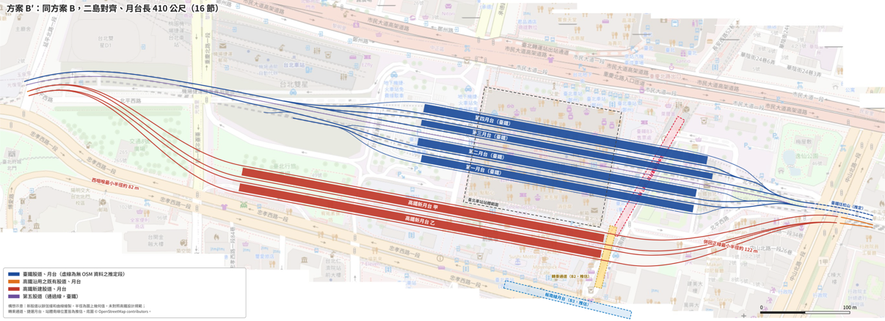

# 方案 B：高鐵新月台與 K 區地下街改建

本文件說明 KitaMeet 所模擬的都市更新提案「方案 B」的內容、幾何參數與推估範圍。方案來源為研究小組的示意圖「方案 B′：同方案 B，二島對齊、月台長 410 公尺（16 節）」，專案內一律稱為方案 B。

## 方案內容

1. 拆除東森廣場 K 區地下街與其地下停車場。
2. 於原 K 區地下街與站前廣場下方新建兩座對齊的高鐵島式月台 甲、乙，長 410 公尺，可停靠 16 節車廂的列車。
3. 既有第 1、2 月台與其包夾的 4 線歸還臺鐵，軌距由 1435 mm 改為 1067 mm。
4. 新建股道東端以最小半徑 122 公尺的正線接回既有高鐵路廊，西端以最小半徑 82 公尺的聯絡線接回。
5. 於 B2 增設南北向轉乘通道，連接新月台與既有月台層。

## 採用的幾何參數

所有參數集中於 `src/data/scenarios/proposal-b.ts`，調整單一常數即可重新產生全部幾何。

| 參數 | 採用值 | 可信度 |
|---|---|---|
| 月台長度 | 410 公尺 | 示意圖指定 |
| 月台寬度 | 12.0 公尺 | 推估 |
| 月台面高程 | −14.5 公尺（B2） | 推估 |
| 兩座月台中心線間距 | 24.0 公尺 | 推估 |
| 股道中心距月台中心線 | ±8.0 公尺 | 推估 |
| 甲 月台中心線南移量 | 38 公尺 | 推估 |
| 乙 月台中心線南移量 | 62 公尺 | 推估 |
| 東側正線最小半徑 | 122 公尺 | 示意圖量測值 |
| 西側聯絡線最小半徑 | 82 公尺 | 示意圖量測值 |
| 緩和曲線長度 | 0.5 × 半徑 | 推估 |
| 轉乘通道寬度 | 12.0 公尺 | 推估 |

新月台的位置並非直接寫入座標，而是由既有第 1 月台（`way/584167409`）的主軸推算：以該月台東端為起點沿主軸往西取 410 公尺，再往南平移上表的位移量。股道由月台中心線平移 ±8 公尺產生，兩端再以反向曲線接回既有路廊的喉管節點（東端取 `way/381111230` 的西端點、西端取 `way/323105864` 的東端點）。

## 拆除與沿用的量體

| 處理 | OSM id | 名稱 |
|---|---|---|
| 拆除 | `way/450732441` | 東森廣場 K 區地下街 |
| 拆除 | `way/204711163` | K 區地下街停車場 |
| 拆除 | `way/204616534` | K 區地下街停車場車道 |
| 歸還臺鐵 | `way/584167409`、`way/584167411` | 第 1、2 月台 |
| 改軌距 | `way/593871124`、`way/593871149`、`way/615600478`、`way/615600479`、`way/615600481` | 站內高鐵股道 |

## 建模過程發現的限制

模型按示意圖的幾何參數建立後，出現兩項與既有結構的衝突，均已保留於模型中並標為推估：

**月台長度與 K 區帶寬不相容。** 月台主軸傾斜約 10.5 度，410 公尺的長度即佔去約 75 公尺的南北向範圍；兩座月台加上寬度後合計約 111 公尺，略大於 K 區地下街輪廓的 104 公尺帶寬。採用的位移量已使南北兩端的超出量相等，各約 3 公尺。

**新建股道的接軌點落在既有喉管之外。** 410 公尺的月台較既有月台長 79 公尺，兩端各超出約 40 公尺，使得以 122 公尺與 82 公尺半徑的反向曲線接回路廊時，接軌完成處會落在既有喉管以外：東端約 100 至 146 公尺、西端約 150 至 180 公尺。換言之，方案 B 必須同時改建既有高鐵進站段的隧道線形，而非僅於站區內施作。

## 推估與未驗證的項目

- 轉乘通道、捷運月台、站體牆線位置皆為推估。
- 新建股道的半徑取自示意圖的圖面幾何，未對照高鐵的設計規範（超高、豎曲線、道岔型式皆未檢核）。
- 月台位於 B2、與既有月台同層，但新月台南側的既有地下結構（K 區停車場、站前地下街）如何讓出空間並未模擬。
- 拆除 K 區地下街對行人動線與商業空間的影響不在模型範圍。

圖面與幾何的基礎資料來源為 OpenStreetMap contributors，授權為 ODbL。
